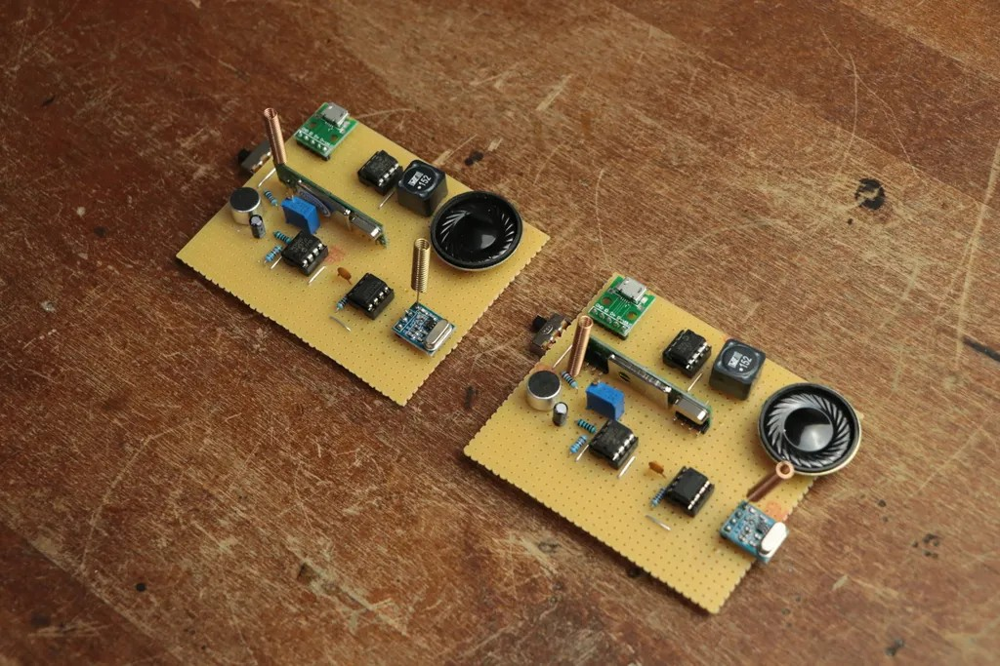

# Wireless Walkie-Talkie Communication System

[](https://whimsical-strudel-0f2465.netlify.app/)


A pair of identical wireless walkie-talkie units built on perfboard. Each unit has a microphone and a speaker, so two people can talk to each other over a wireless link.

<p align="center">
  
  <br/><i>The two walkie-talkie units</i>
</p>

---

## 📌 Overview

This project is a two-way wireless voice communication system. Both units are built the same way, so either one can be used to talk and to listen. The circuits are soldered on perfboard and powered through a USB power board.

## 🧩 What Each Unit Contains

Each of the two boards has:

- Microphone to pick up the voice
- Speaker to play the received voice
- Wireless module with an antenna for the radio link
- Small 8-pin ICs for the audio circuit
- Trimmer potentiometer (adjustable control)
- Slide switch for power on/off
- USB connector board for the power supply
- Resistors, capacitors and an inductor on perfboard

## ⚙️ How It Works

1. The microphone converts the voice into an electrical signal.
2. The audio circuit prepares the signal.
3. The wireless module sends it through the antenna.
4. The second unit receives the signal.
5. The audio circuit amplifies it and the speaker plays the voice.

## 📁 Project Structure

```
Wireless-Walkie-Talkie/
├── images/
│   └── prototype.jpg
└── README.md
```

## 🔮 Possible Improvements

- Add a circuit diagram and component list to this repository
- Add a volume control and a push-to-talk button
- Test and document the working range
- Design a PCB and a case for the units

## 👩‍💻 Author

**Munazza Hawaldar**
E&TC Diploma, Government Polytechnic, Solapur (2026)
[LinkedIn](https://www.linkedin.com/in/munazza-hawaldar-644b0041a/) · [Portfolio](https://whimsical-strudel-0f2465.netlify.app/)
